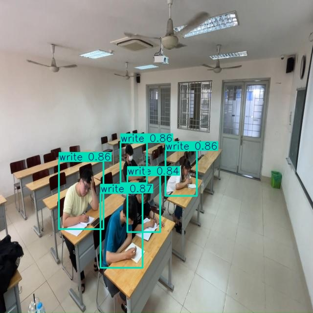
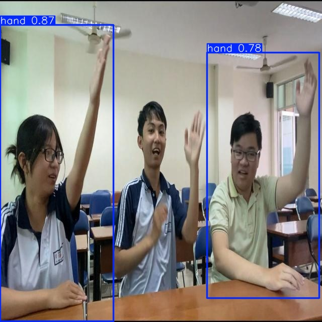
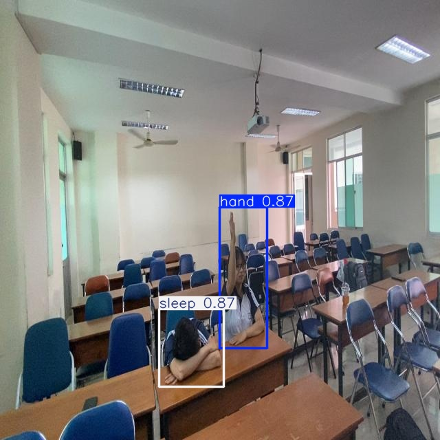
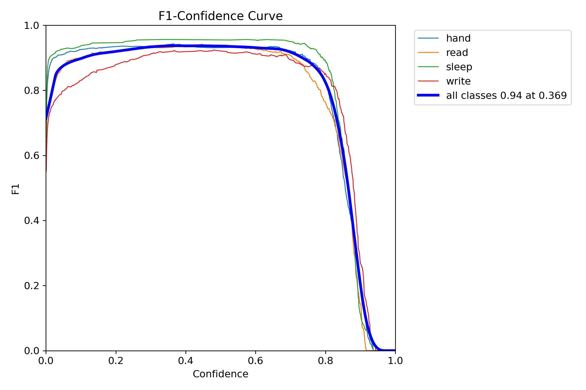
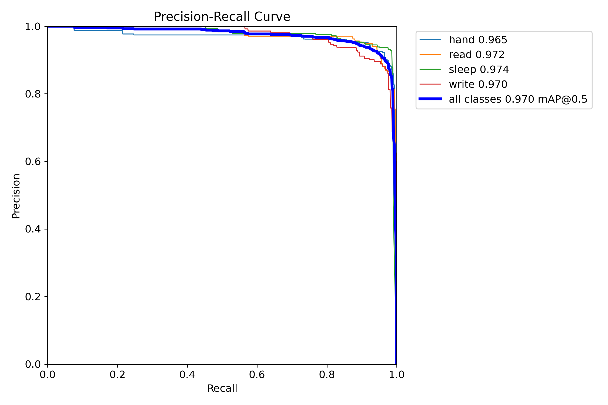
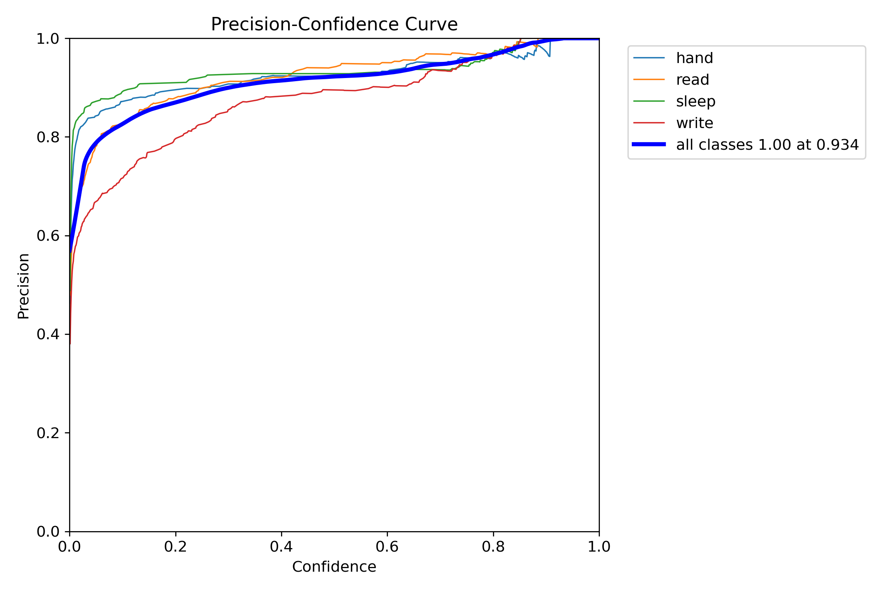
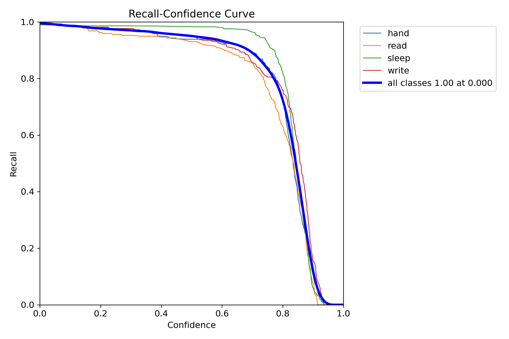
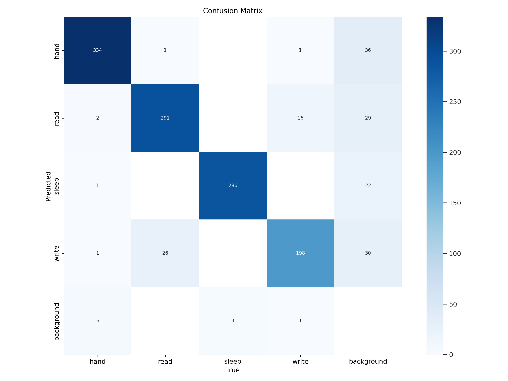
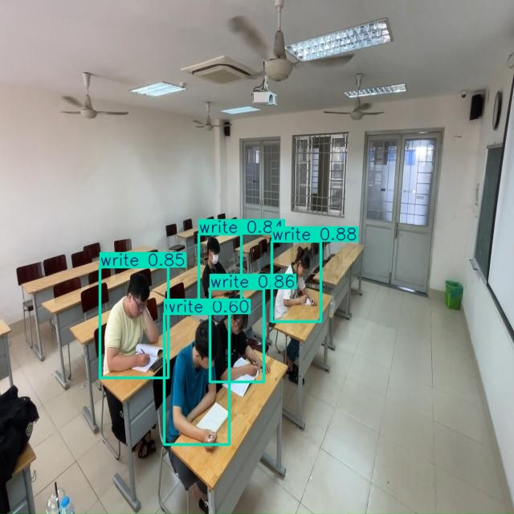

# Détection des comportements en classe avec YOLOv8

Projet de vision par ordinateur qui détecte automatiquement ce que font les élèves dans une salle de classe,
en fine-tunant **YOLOv8n** sur un dataset de 7 485 images.

<p align="center">
  
  
  
</p>

## Résultats en bref

| mAP50 | mAP50-95 | Précision | Rappel | F1 max | Inférence | Entraînement |
|:-----:|:--------:|:---------:|:------:|:------:|:---------:|:------------:|
| **0.970** | **0.716** | 0.914 | 0.960 | 0.94 | 4.5 ms / image | 20 min (T4) |

Le modèle ne pèse que **6.3 Mo** (3 M de paramètres) et tourne largement assez vite pour du temps réel.

## Objectif

Reconnaître 4 comportements :

| Classe | Signification |
|--------|---------------|
| `hand`  | Main levée |
| `read`  | Lecture |
| `sleep` | Endormissement |
| `write` | Écriture |

## Technologies

- Python 3.10, PyTorch 2.4
- Ultralytics 8.3.49 — YOLOv8 nano (`yolov8n`, pré-entraîné sur COCO)
- Roboflow (dataset)
- Kaggle Notebook avec GPU Tesla T4

## Dataset

Dataset **Classroom** (version 24) hébergé sur Roboflow, au format YOLOv8 — source : `mariotn689/classroom-coc8d`.

| Split | Images | Part |
|-------|-------:|-----:|
| Train | 6 180 | 83 % |
| Validation | 425 | 6 % |
| Test | 880 | 12 % |
| **Total** | **7 485** | |

Les images sont des frames extraites de vidéos tournées dans des salles de classe.

## Méthode

1. Téléchargement du dataset avec l'API Roboflow
2. Fine-tuning de `yolov8n` : 15 époques, images 704×704, batch 16, optimiseur AdamW (choisi automatiquement, lr = 0.00125)
3. Analyse des courbes (F1, précision, rappel, PR) et de la matrice de confusion
4. Validation du meilleur modèle (`best.pt`)
5. Prédiction sur les 880 images de test avec un seuil de confiance de 0.50

## Résultats détaillés

### Évolution de l'entraînement

| Époque | box_loss | cls_loss | Précision | Rappel | mAP50 | mAP50-95 |
|-------:|---------:|---------:|----------:|-------:|------:|---------:|
| 1  | 1.297 | 1.701 | 0.739 | 0.886 | 0.859 | 0.549 |
| 5  | 1.113 | 0.745 | 0.869 | 0.916 | 0.933 | 0.641 |
| 10 | 0.969 | 0.493 | 0.894 | 0.957 | 0.957 | 0.684 |
| 14 | 0.889 | 0.427 | 0.914 | 0.960 | **0.970** | **0.716** |
| 15 | 0.872 | 0.406 | 0.924 | 0.946 | 0.964 | 0.716 |

- Dès la 1re époque, le mAP50 atteint 0.86 : le pré-entraînement COCO sait déjà localiser les personnes.
- La perte de classification est divisée par 4 : l'essentiel de l'apprentissage consiste à **distinguer les comportements**.
- Les pertes baissent encore à l'époque 15 : **le modèle n'a pas fini de converger**, plus d'époques devraient encore l'améliorer.

### Par classe (jeu de validation : 425 images, 1 167 objets)

| Classe | Objets | Précision | Rappel | mAP50 | mAP50-95 |
|--------|-------:|----------:|-------:|------:|---------:|
| **Toutes** | 1167 | **0.914** | **0.960** | **0.970** | **0.716** |
| hand   | 344 | 0.924 | 0.949 | 0.965 | 0.702 |
| read   | 318 | 0.921 | 0.947 | 0.972 | 0.720 |
| sleep  | 289 | 0.928 | **0.985** | 0.974 | 0.683 |
| write  | 216 | 0.883 | 0.958 | 0.970 | **0.759** |

- `sleep` est la classe la mieux détectée (rappel 0.985), mais ses boîtes sont les moins précises (mAP50-95 0.683).
- `write` a la précision la plus faible (0.883) : c'est la classe qui produit le plus de fausses détections.
- L'écart entre mAP50 (0.97) et mAP50-95 (0.72) montre que les élèves sont bien trouvés, mais que les boîtes ne sont pas toujours ajustées au pixel près.

### Courbes

| F1 – Confiance | Précision – Rappel |
|:---:|:---:|
|  |  |
| F1 max de **0.94 au seuil 0.369**, avec un plateau large (≈ 0.25 à 0.70) : le modèle est peu sensible au choix du seuil. | Les 4 classes sont collées au coin supérieur droit (mAP50 = 0.97). |

<details>
<summary>Courbes précision et rappel en fonction de la confiance</summary>

| Précision | Rappel |
|:---:|:---:|
|  |  |

</details>

### Matrice de confusion

<p align="center"></p>

- La seule vraie confusion entre classes est **`read` ↔ `write`** (26 lectures prédites comme écriture, 16 dans l'autre sens) :
  les deux postures, tête penchée sur la table, se ressemblent beaucoup.
- `hand` et `sleep` ne sont presque jamais confondues avec une autre classe.
- La plupart des erreurs sont des **fausses détections sur le fond** (≈ 117) plutôt que des élèves manqués (10).
  Le seuil de 0.50 utilisé en prédiction permet d'en éliminer une partie.

### Exemples de prédictions sur le jeu de test (seuil 0.50)

| | |
|:---:|:---:|
|  |  |
|  |  |

Sur l'image en bas à droite, l'élève du milieu (main levée) n'est **pas détecté** au seuil de 0.50 : exemple d'élève manqué,
probablement à cause du chevauchement avec ses voisins.

## Limites

- **Scores probablement optimistes** : les images sont des frames issues de quelques vidéos. Des frames presque identiques
  peuvent se retrouver dans train et validation, ce qui gonfle les résultats par rapport à une salle de classe inconnue.
- Les métriques sont mesurées sur un jeu de validation assez petit (425 images). Le jeu de test, annoté, n'a pas été évalué.
- Le dataset contient des labels dupliqués sur certaines images (signalés par Ultralytics pendant l'entraînement).

## Installation

```bash
pip install ultralytics roboflow
```

## Utilisation

1. Créez un compte Roboflow et récupérez votre clé API
2. Définissez la clé dans une variable d'environnement (sur Kaggle : *Add-ons → Secrets*) :

```bash
export ROBOFLOW_API_KEY="votre_cle"
```

3. Ouvrez et exécutez [`yolov8_finetuning.ipynb`](yolov8_finetuning.ipynb) (Kaggle ou en local avec un GPU)

Prédiction avec le modèle entraîné :

```bash
yolo task=detect mode=predict model=runs/detect/train/weights/best.pt conf=0.50 source=chemin/vers/images
```

Évaluation sur le jeu de test :

```bash
yolo task=detect mode=val model=runs/detect/train/weights/best.pt data=classroom-24/data.yaml split=test
```

## Structure du projet

```
.
├── yolov8_finetuning.ipynb   # Notebook complet commenté (entraînement + analyse)
├── images/                   # Courbes, matrice de confusion et exemples de prédictions
└── README.md
```

## Pistes d'amélioration

- Entraîner plus longtemps (50 à 100 époques avec `patience=20`), le modèle n'ayant pas convergé
- Tester `yolov8s` / `yolov8m` pour mieux séparer `read` et `write`
- Évaluer sur le jeu de test et séparer les splits **par vidéo** pour mesurer la vraie généralisation
- Nettoyer les labels dupliqués et ajouter des exemples difficiles `read` / `write`
- Ajouter la détection en temps réel avec une webcam et compter les comportements par séance

## Auteur

Makhtar Faye
